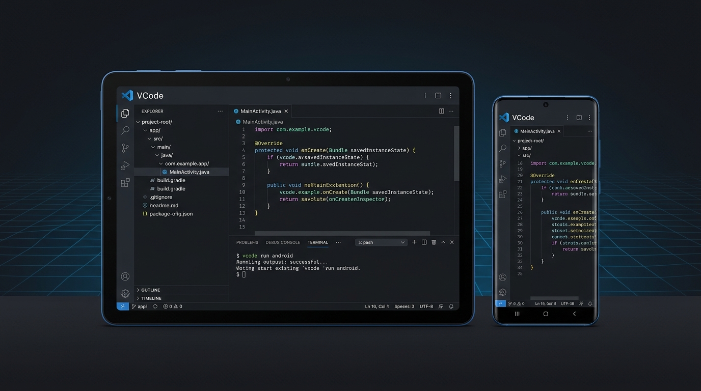
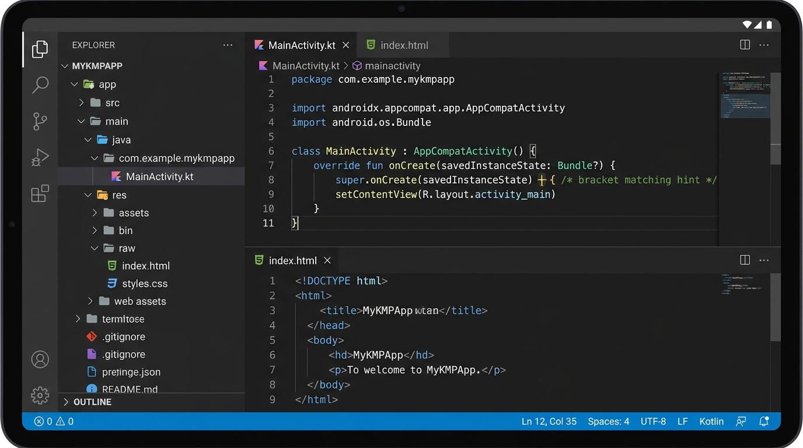
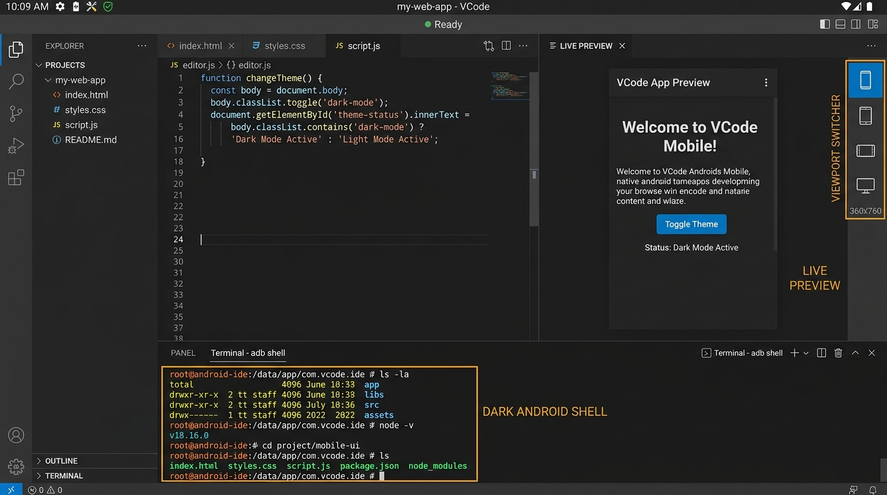

# VCode — Native Android IDE

[](LICENSE)
[](PRIVACY.md)
[-3DDC84.svg)](#build-signed-release-apk)
[](#architecture)
[](#architecture)



**VCode** is a native Android application inspired by Visual Studio Code, built with **Kotlin**, **Jetpack Compose**, and **Material 3** for Android phones and tablets (Android 8.0+ / API 26+, edge-to-edge portrait and landscape).

---

## Screenshots

| Adaptive Tablet & Multi-Tab Code Editor | Split-Screen Live Preview & Android Terminal |
| :---: | :---: |
|  |  |

---

## Key Features

- **VS Code Workbench UI**: Activity Sidebar, File Explorer, Multi-Tab Code Editor, Resizable Bottom Panel (Terminal, Output, Problems), Workspace Search & Replace, Source Control, Extensions, Settings, Status Bar, and Command Palette.
- **Advanced Native Code Editor (Sora Editor + TextMate)**:
  - Syntax highlighting for **15 languages**: HTML, CSS, JavaScript, TypeScript, Python, Java, Kotlin, C, C++, JSON, XML, PHP, SQL, Markdown, and Shell Script.
  - Line numbers, auto-indentation, code completion, bracket matching, find & replace, undo/redo, code folding, minimap rail, custom font families/sizes, hardware keyboard shortcuts (`Ctrl+S`, `Ctrl+F`, `Ctrl+Shift+P`, `Ctrl+\``), and configurable auto-save.
  - Built-in VS Code themes: **Dark+**, **One Dark Pro**, **Dracula**, **Monokai**, **Light+**, and **GitHub Light**.
- **File & Project Management**:
  - Create, rename, delete, copy, cut, and paste files/folders with file-extension badges.
  - **Android Storage Access Framework (SAF)** integration (`OpenDocument`, `OpenDocumentTree`, `CreateDocument`) for importing/exporting files and folders.
  - Project templates, recent projects persistence (Room), and one-tap **ZIP project export**.
- **Integrated Shell Terminal**:
  - Real multi-session `/system/bin/sh` execution with ANSI color parsing, command history, `Ctrl+C` interrupt, clear, resizable panel, plus built-in `git` (Eclipse JGit) and `js`/`node` (Mozilla Rhino).
- **Live Preview & Responsive Device Viewport**:
  - Local `WebView` (`https://vcode.local/` via `shouldInterceptRequest`) for HTML/CSS/JS with console log & error capture, refresh, and split-screen editor + preview.
  - Device viewport presets (**Mobile**, **Tablet**, **Desktop**, **Responsive**, and **Custom W×H**), Portrait/Landscape rotation toggle, and drag-to-resize preview frame.
- **Source Control (Eclipse JGit)**:
  - Initialize Git repositories, view working-tree diff status, stage/unstage files, and commit locally on device.

---

## Architecture

- **Language & UI**: Kotlin, Jetpack Compose, Material 3 (`material3-window-size-class` for phone & tablet layouts)
- **Pattern**: MVVM (`VCodeViewModel` + unidirectional `StateFlow` UI state)
- **Persistence**: Room (`AppDatabase`) + Jetpack DataStore (`SettingsRepository`)
- **Code Editor**: Sora CodeEditor (`io.github.rosemoe:editor` + `language-textmate`)
- **Version Control & Scripting**: Eclipse JGit + Mozilla Rhino

---

## Build Signed Release APK

```bash
./gradlew assembleRelease
```

Run unit tests:

```bash
./gradlew testReleaseUnitTest
```

Signed release APK output path:

```text
app/build/outputs/apk/release/app-release.apk
```

---

## Legal & Documentation

- **License**: [Apache License 2.0](LICENSE)
- **Privacy Policy**: [PRIVACY.md](PRIVACY.md)
